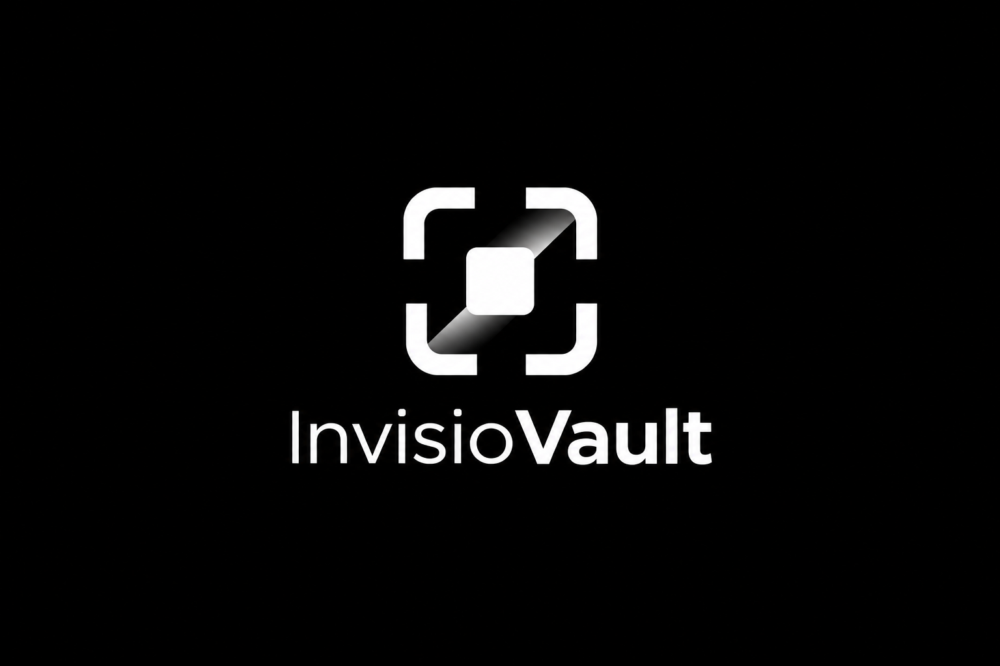

<p align="center">
  
</p>

<h1 align="center">InvisioVault</h1>

<p align="center">
  <strong>Steganography, Universal Polyglots & Stealth QR Codes</strong><br/>
  Conceal confidential files inside images, documents, audio, and scannable QR codes with authenticated encryption.
</p>

<p align="center">
  <a href="https://invisio-vault.vercel.app"></a>
  
  
  
  
  
</p>

---

## Overview

InvisioVault is an open-source cybersecurity and steganography toolkit. It allows you to conceal confidential files and messages inside ordinary carrier files (images, PDFs, media, and QR codes) with zero visual distortion, robust error correction, and authenticated encryption.

---

## Features

- **Primary Image Steganography (V6 Advanced Engine):**
  - **Matrix (3,2) Coset Syndrome Coding:** Embeds 2 payload bits into every 3 carrier channels with at most 1 bit modification (average 0.375 flips/bit), reducing carrier modifications by 25% compared to standard LSB replacement.
  - **10-Round Balanced Feistel Channel Permutation:** Disperses payload bits pseudorandomly across carrier coordinates using an in-memory 10-round Feistel network with precomputed AES-256-CTR tables (160 KiB L2 cache footprint) and cycle walking with a 100-iteration defensive runtime guard.
  - **Interleaved Reed-Solomon RS(255, 223):** Dynamic-group block interleaving ($K=4$) correcting up to 16 symbol errors per 255-byte block and tolerating up to 64 contiguous burst bytes.
  - **Dual Operational Modes:** Password-protected Encrypted Mode (PBKDF2-HMAC-SHA256 with 600,000 iterations, two-tier HKDF key separation, Fernet AES-128-CBC, and HMAC-SHA256 header authentication) and Plain Mode (CRC-32 payload framing with SHA-256 integrity verification).
  - **57-Byte Authenticated Header:** Anti-downgrade enforcement binding mode flags, salt, and length parameters with strict MAC verification before payload processing.
  - **Automatic Multi-Engine Extraction:** Universal extraction pipeline automatically detects carrier wire formats (V1–V6) and safely dispatches to the correct engine without manual user selection.
- **Universal Polyglots:** Merges files so they open normally as images, videos, or PDFs, but extract as fully valid archives when opened in 7-Zip, WinRAR, or Archive Utility.
- **Stealth QR Codes:** Conceals encrypted payloads inside standard-looking QR codes that scan harmlessly with everyday camera apps while decrypting inside InvisioVault.

---

## Quick Start

### Windows

Run `run.bat` to launch both the backend and frontend automatically.

### Manual Setup

1. **Backend (Python 3.10+):**
   ```bash
   cd backend
   python -m venv .venv
   # Windows: .venv\Scripts\activate | Linux/macOS: source .venv/bin/activate
   pip install -r requirements.txt
   python app.py
   ```

2. **Frontend (Node 18+):**
   ```bash
   cd frontend
   npm install
   npm run dev
   ```

---

## Documentation

Comprehensive guides and technical specifications are available in the [`docs/`](docs/) directory:

| Document | Focus |
|---|---|
| [Architecture & Cryptography](docs/ARCHITECTURE.md) | Wire formats, Sobel filter mathematics, and binary offset algorithms. |
| [V6 Technical Specification](docs/V6_SPECIFICATION.md) | Matrix (3,2) coset coding, 10-round Feistel permutation, and interleaved Reed-Solomon. |
| [REST API Reference](docs/API.md) | Endpoint specifications, payloads, and examples. |
| [OpenAPI Specification](docs/openapi.yaml) | Full OpenAPI 3.0.3 schema definition. |
| [Security Policy](SECURITY.md) | Threat model, responsible disclosure, and cryptographic guarantees. |
| [Contributing Guidelines](CONTRIBUTING.md) | Local setup, standards, and pull request workflow. |
| [Changelog](CHANGELOG.md) | Version history and release notes. |

---

## Origin Story

This was my first-ever repo. The original code was *ambitious*. I came back, learned cryptography properly, and rebuilt it from scratch. If you're a beginner: keep shipping. The rough early code is proof you're growing.

---

## Author

Created and maintained by **[Rolan (RNR)](https://rolan-rnr.netlify.app/)**
- GitHub: [@rolan-r-n-r](https://github.com/rolan-r-n-r)
- Email: [rolanlobo901@gmail.com](mailto:rolanlobo901@gmail.com)
- Twitter/X: [@Rolan_RNR](https://x.com/Rolan_RNR)

Distributed under the [MIT License](LICENSE).
